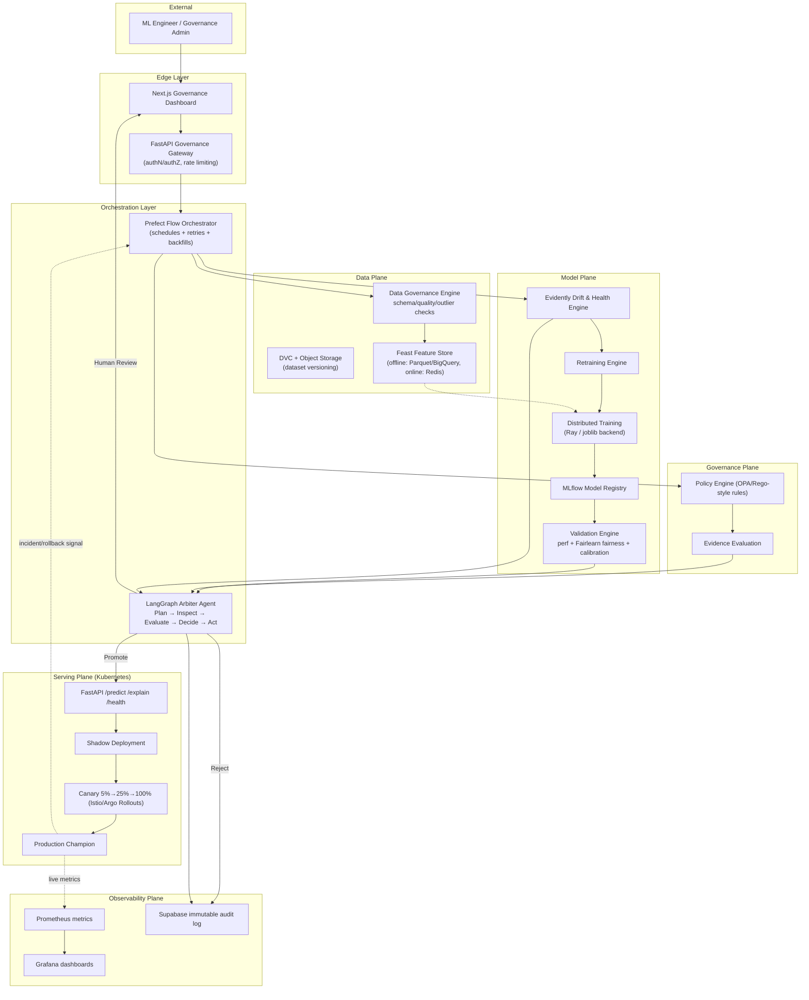

# PROJECT.md — Arbiter: Agentic Credit-Risk Governance Platform

**A production-grade, horizontally scalable MLOps system for autonomous, auditable model governance in regulated finance.**

This document is the engineering blueprint behind `README.md`. It exists so that (a) the system can actually be rebuilt by a contributor, and (b) every file in the repo maps to a function signature and a runnable snippet you can reproduce on a whiteboard.

---

## 1. Executive Architecture Overview

### 1.1 What Arbiter actually is

Arbiter is not "a model behind an API." It is a **closed-loop governance system**: data flows in, candidates get trained, an agent gathers evidence across performance/fairness/drift/policy, and a decision gate — not a human clicking "approve" — decides whether a model is allowed to touch production traffic. Humans only sit in the loop for the borderline 10–20% of cases the policy engine can't resolve deterministically.

### 1.2 System architecture (Mermaid)



### 1.3 Linear workflow

```
Raw Data → DVC snapshot → Data Governance Engine → Feast (offline+online store)
    → Drift & Health Engine → Retraining Engine → Distributed Training
    → MLflow Registry → Validation Engine (perf/fairness/calibration)
    → Policy Engine → LangGraph Arbiter Agent (evidence synthesis + reasoning)
    → Decision Gate → {Promote → Staging→Shadow→Canary→Prod | Human Review | Reject}
    → Immutable Audit Log (Supabase) + Prometheus/Grafana continuous monitoring
    → incident detected → automated rollback → retraining trigger (loop closes)
```

---

## 2. Tech Stack Justification Matrix

| Layer | Chosen Tool | Alternative(s) | Scalability | Latency | Ecosystem Integration | Maintenance Overhead | Why chosen |
|---|---|---|---|---|---|---|---|
| Language/runtime | Python 3.11 | Python 3.9, Go | High (perf improvements, better typing) | N/A | Best-in-class ML ecosystem | Low | 3.11's faster CPython + `typing` maturity fits ML + async serving |
| Data versioning | DVC | Delta Lake, LakeFS | High (works with any object store) | N/A | Git-native, plays well with MLflow | Low | Git-like semantics for data; team already lives in Git |
| Feature store | Feast | Tecton, Hopsworks | High (Redis online store scales horizontally) | Low (<10ms online reads) | Open-source, no vendor lock-in | Medium | Free, self-hostable; separates offline training features from low-latency online serving |
| Orchestration | Prefect | Airflow, Dagster | High (dynamic DAGs, native retries) | N/A | Pythonic API, less boilerplate than Airflow | Low | Airflow's DAG-as-config is heavier for a project this size; Prefect flows are just Python functions |
| Experiment tracking | MLflow | Weights & Biases, Neptune | High (self-hosted, scales with backend DB) | N/A | Works with sklearn/XGBoost/LightGBM/PyTorch natively | Low | Free, self-hosted, doubles as the Model Registry (no extra tool needed) |
| Distributed training | Ray (optional, joblib fallback) | Spark MLlib, Dask | High (elastic worker pool) | N/A | Native sklearn/XGBoost/LightGBM parallel backends | Medium | Ray scales from a laptop to a cluster with the same API — good growth story for the resume |
| Agent orchestration | LangGraph | AutoGen, CrewAI | Medium-High (stateful graph, checkpointable) | Medium (LLM call bound) | First-class support for tool-calling + cycles | Medium | Governance decisions need branching/looping state machines, not linear chains — LangGraph models this directly |
| LLM inference (agent) | Groq (Llama 3.x) | OpenAI, Anthropic API | High (Groq's LPU is very low latency) | Very low | OpenAI-compatible SDK | Low | Fast + cheap for a reasoning agent that must run on every candidate |
| Explainability | SHAP | LIME, Captum | Medium (TreeExplainer scales well for tree models) | Medium (cached at online time) | Native XGBoost/LightGBM support | Low | Industry standard in regulated ML; TreeSHAP is fast enough for online explanation |
| Fairness/calibration | Fairlearn | AIF360 | High | Low (batch computation) | Native sklearn-compatible metrics | Low | Simpler API, actively maintained, sufficient metric coverage (demographic parity, disparate impact) |
| Drift monitoring | Evidently AI | NannyML, WhyLogs | High (stateless report generation) | Low | Generates HTML/JSON reports pluggable into pipelines | Low | Best open-source drift report ergonomics; plugs into Prefect flows trivially |
| Serving | FastAPI | Flask, Django REST | High (async, ASGI) | Very low | Native async, Pydantic validation, OpenAPI docs free | Low | Async I/O matters once you add SHAP + feature-store calls per request |
| Containerization | Docker | Podman | High | N/A | Universal | Low | Industry default |
| Orchestration (infra) | Kubernetes (Minikube for local, EKS/GKE for prod) | Docker Compose, Nomad | Very High (horizontal pod autoscaling) | N/A | Works with Argo Rollouts for canary | High | Needed to demonstrate real canary/shadow rollout patterns, not just docker-compose toy scaling |
| Progressive delivery | Argo Rollouts | Flagger | High | N/A | Native K8s CRDs | Medium | Declarative canary steps (5%→25%→100%) match the governance decision gate directly |
| Audit store | Supabase (Postgres) | DynamoDB, raw Postgres | High | Low | Realtime subscriptions for dashboard | Low | Managed Postgres + instant REST/Realtime API, keeps infra small |
| Monitoring | Prometheus + Grafana | Datadog, New Relic | Very High | Low (pull-based scraping) | K8s-native via `kube-prometheus-stack` | Medium | Free, the de-facto K8s observability standard, great resume signal |
| CI/CD | GitHub Actions | Jenkins, GitLab CI | High (matrix builds) | N/A | Native to GitHub | Low | Zero infra to maintain, good enough for lint/test/build/push |
| Dashboard | Next.js on Vercel | Streamlit, Retool | High (edge-cached, SSR) | Low | Easy Supabase Realtime integration | Low | Production-grade frontend > a Streamlit toy for a resume project |

---

## 3. Scalability Architecture

**Decoupling data and compute:** Feast separates *feature computation* (batch, Spark/Pandas jobs writing to the offline store) from *feature serving* (Redis online store, sub-10ms reads). Training reads from the offline store; the FastAPI serving layer reads only from the online store — so a spike in inference traffic never contends with a nightly feature-materialization job.

**Distributed training:** `TrainingEngine` is written against a `joblib`-compatible backend interface. Locally it runs `n_jobs=-1` on a single machine; behind a feature flag it registers a `ray` backend (`ray.util.joblib.register_ray()`) so the exact same `GridSearchCV`/`RandomizedSearchCV` call fans out across a Ray cluster with zero code changes in the calling code — this is the single most interview-relevant scaling story in the repo.

**Async inference:** The FastAPI app uses `async def` endpoints; SHAP computation and Feast online lookups are dispatched via `asyncio.gather` so a `/predict` call does feature fetch + inference + explanation concurrently rather than serially.

**Container orchestration:** Each service (gateway, orchestrator worker, model server, drift-check cron) is its own Docker image, deployed as an independent Kubernetes `Deployment` with its own `HorizontalPodAutoscaler` targeting CPU/RPS. The model server scales independently from the Prefect worker pool, which scales independently from the agent-reasoning pods (LLM-bound, so autoscaled on queue depth, not CPU).

**Progressive rollout as a scaling *and* safety mechanism:** Argo Rollouts steps traffic 5%→25%→100% behind the same Kubernetes Service, with automatic rollback wired to Prometheus alert rules (e.g., `error_rate > 2%` or `fairness_metric_drift > threshold` triggers `kubectl argo rollouts abort`).

**Feature-store caching:** Redis online store is read-through cached; repeated `/predict` calls for the same entity key within a TTL window skip the Feast round-trip entirely.

---

## 4. Directory Structure

```
arbiter-credit-governance/
├── PROJECT.md
├── README.md
├── requirements.txt
├── pyproject.toml
├── docker-compose.yml
├── Dockerfile.api
├── Dockerfile.worker
├── .env.example
├── .github/
│   └── workflows/
│       ├── ci.yml
│       └── cd.yml
├── k8s/
│   ├── base/
│   │   ├── api-deployment.yaml
│   │   ├── api-hpa.yaml
│   │   ├── worker-deployment.yaml
│   │   └── service.yaml
│   └── rollout/
│       └── canary-rollout.yaml
├── src/
│   ├── config.py
│   ├── data/
│   │   ├── ingestion.py
│   │   ├── validation.py
│   │   ├── quarantine.py
│   │   └── versioning.py
│   ├── features/
│   │   ├── feature_repo.py
│   │   ├── transformations.py
│   │   └── online_store.py
│   ├── drift/
│   │   ├── detector.py
│   │   └── persistence.py
│   ├── training/
│   │   ├── dataset_builder.py
│   │   ├── trainer.py
│   │   ├── distributed_backend.py
│   │   └── registry.py
│   ├── validation/
│   │   ├── performance.py
│   │   ├── fairness.py
│   │   ├── calibration.py
│   │   └── report.py
│   ├── governance/
│   │   ├── policy_engine.py
│   │   ├── evidence.py
│   │   └── rules/
│   │       └── credit_policy.yaml
│   ├── agent/
│   │   ├── graph.py
│   │   ├── nodes.py
│   │   ├── state.py
│   │   └── prompts.py
│   ├── serving/
│   │   ├── main.py
│   │   ├── routes/
│   │   │   ├── predict.py
│   │   │   ├── explain.py
│   │   │   └── health.py
│   │   ├── explainer.py
│   │   └── schemas.py
│   ├── deployment/
│   │   ├── promoter.py
│   │   └── rollback.py
│   ├── monitoring/
│   │   ├── metrics.py
│   │   └── incident.py
│   ├── audit/
│   │   └── logger.py
│   └── orchestration/
│       └── flows.py
├── tests/
│   ├── test_validation.py
│   ├── test_policy_engine.py
│   ├── test_agent_graph.py
│   └── test_serving.py
├── dashboard/            # Next.js app (separate deploy)
└── notebooks/
    └── eda.ipynb
```

---

## 5. File-by-File Technical Blueprint

Every file below follows: **Purpose → Key Signatures → Snippet**.

### 5.1 `src/config.py`
**Purpose:** Centralized, typed settings loaded from environment variables (Pydantic `BaseSettings`) so no module reads `os.environ` directly.

**Key signatures:**
```python
class Settings(BaseSettings):
    mlflow_tracking_uri: str
    supabase_url: str
    supabase_key: str
    groq_api_key: str
    redis_host: str = "localhost"


def get_settings() -> Settings: ...
```

**Snippet:**
```python
from functools import lru_cache
from pydantic_settings import BaseSettings


class Settings(BaseSettings):
    mlflow_tracking_uri: str = "http://localhost:5000"
    redis_host: str = "localhost"
    groq_api_key: str

    class Config:
        env_file = ".env"


@lru_cache
def get_settings() -> Settings:
    return Settings()
```

---

### 5.2 `src/data/ingestion.py`
**Purpose:** Pulls raw records from multiple sources (historical CSV/DB dump, live loan applications, label feed) into a single normalized `DataFrame`.

**Key signatures:**
```python
def load_historical(path: str) -> pd.DataFrame: ...
def load_live_batch(since: datetime) -> pd.DataFrame: ...
def merge_sources(frames: list[pd.DataFrame]) -> pd.DataFrame: ...
```

**Snippet:**
```python
import pandas as pd
from datetime import datetime


def load_historical(path: str) -> pd.DataFrame:
    df = pd.read_parquet(path)
    df["source"] = "historical"
    return df


def merge_sources(frames: list[pd.DataFrame]) -> pd.DataFrame:
    merged = pd.concat(frames, ignore_index=True)
    return merged.drop_duplicates(subset=["applicant_id", "as_of_date"])
```

---

### 5.3 `src/data/validation.py`
**Purpose:** Schema, null, type, and range enforcement — the gate between raw and quarantined/versioned data.

**Key signatures:**
```python
class ValidationResult(BaseModel):
    is_valid: bool
    failed_rules: list[str]


def validate_schema(df: pd.DataFrame, schema: dict) -> ValidationResult: ...
def check_ranges(df: pd.DataFrame, ranges: dict[str, tuple]) -> list[str]: ...
```

**Snippet:**
```python
def validate_schema(df: pd.DataFrame, schema: dict[str, str]) -> ValidationResult:
    failed = []
    for col, dtype in schema.items():
        if col not in df.columns:
            failed.append(f"missing_column:{col}")
        elif str(df[col].dtype) != dtype:
            failed.append(f"dtype_mismatch:{col}")
    return ValidationResult(is_valid=len(failed) == 0, failed_rules=failed)
```

---

### 5.4 `src/data/quarantine.py`
**Purpose:** Routes failed rows to a quarantine table/bucket instead of dropping them silently, and raises an alert.

**Key signatures:**
```python
def quarantine_rows(df: pd.DataFrame, reason: str) -> None: ...
def alert_on_quarantine(count: int, reason: str) -> None: ...
```

**Snippet:**
```python
def quarantine_rows(df: pd.DataFrame, reason: str) -> None:
    df = df.assign(quarantine_reason=reason, quarantined_at=pd.Timestamp.utcnow())
    df.to_parquet(f"quarantine/{reason}_{pd.Timestamp.utcnow().date()}.parquet")
    alert_on_quarantine(len(df), reason)
```

---

### 5.5 `src/data/versioning.py`
**Purpose:** Wraps DVC to snapshot a validated dataset and record its hash/lineage in the audit log.

**Key signatures:**
```python
def snapshot_dataset(df: pd.DataFrame, name: str) -> str:  # returns dvc hash
```

**Snippet:**
```python
import subprocess, hashlib


def snapshot_dataset(df: pd.DataFrame, name: str) -> str:
    path = f"data/versioned/{name}.parquet"
    df.to_parquet(path)
    subprocess.run(["dvc", "add", path], check=True)
    with open(path, "rb") as f:
        return hashlib.sha256(f.read()).hexdigest()
```

---

### 5.6 `src/features/feature_repo.py`
**Purpose:** Feast feature view + entity definitions — the single source of truth for what a "feature" means across training and serving.

**Key signatures:**
```python
applicant = Entity(name="applicant_id", join_keys=["applicant_id"])
credit_features_view = FeatureView(
    name="credit_features", entities=[applicant], ttl=timedelta(days=1), schema=[...]
)
```

**Snippet:**
```python
from feast import Entity, FeatureView, Field, FileSource
from feast.types import Float32
from datetime import timedelta

applicant = Entity(name="applicant_id", join_keys=["applicant_id"])
source = FileSource(path="data/versioned/features.parquet", timestamp_field="event_ts")

credit_features_view = FeatureView(
    name="credit_features",
    entities=[applicant],
    ttl=timedelta(days=1),
    schema=[Field(name="debt_to_income", dtype=Float32)],
    source=source,
)
```

---

### 5.7 `src/features/online_store.py`
**Purpose:** Thin, cached wrapper around Feast's online (Redis) reads used by the serving layer.

**Key signatures:**
```python
async def get_online_features(entity_id: str, feature_refs: list[str]) -> dict[str, float]: ...
```

**Snippet:**
```python
from functools import lru_cache
from feast import FeatureStore

_store = FeatureStore(repo_path="src/features")


async def get_online_features(entity_id: str, feature_refs: list[str]) -> dict[str, float]:
    resp = _store.get_online_features(
        features=feature_refs, entity_rows=[{"applicant_id": entity_id}]
    )
    return resp.to_dict()
```

---

### 5.8 `src/drift/detector.py`
**Purpose:** Runs an Evidently `DataDriftPreset` comparing baseline vs. production distributions and returns a structured verdict.

**Key signatures:**
```python
class DriftReport(BaseModel):
    drifted_features: list[str]
    dataset_drift: bool


def detect_drift(reference: pd.DataFrame, current: pd.DataFrame) -> DriftReport: ...
```

**Snippet:**
```python
from evidently.report import Report
from evidently.metric_preset import DataDriftPreset


def detect_drift(reference: pd.DataFrame, current: pd.DataFrame) -> DriftReport:
    report = Report(metrics=[DataDriftPreset()])
    report.run(reference_data=reference, current_data=current)
    result = report.as_dict()["metrics"][0]["result"]
    drifted = [c for c, v in result["drift_by_columns"].items() if v["drift_detected"]]
    return DriftReport(drifted_features=drifted, dataset_drift=result["dataset_drift"])
```

---

### 5.9 `src/drift/persistence.py`
**Purpose:** Decides whether drift is transient noise or a persistent shift worth triggering retraining, using a rolling window vote.

**Key signatures:**
```python
def is_persistent_drift(recent_reports: list[DriftReport], min_consecutive: int = 3) -> bool: ...
```

**Snippet:**
```python
def is_persistent_drift(recent_reports: list[DriftReport], min_consecutive: int = 3) -> bool:
    flags = [r.dataset_drift for r in recent_reports[-min_consecutive:]]
    return len(flags) == min_consecutive and all(flags)
```

---

### 5.10 `src/training/dataset_builder.py`
**Purpose:** Builds the leakage-checked train/val/test split with recency weighting and class balancing.

**Key signatures:**
```python
def build_splits(
    df: pd.DataFrame, target: str, cutoff_date: datetime
) -> tuple[pd.DataFrame, pd.DataFrame, pd.DataFrame]: ...
def check_leakage(train: pd.DataFrame, test: pd.DataFrame, key: str) -> bool: ...
```

**Snippet:**
```python
def check_leakage(train: pd.DataFrame, test: pd.DataFrame, key: str) -> bool:
    overlap = set(train[key]) & set(test[key])
    if overlap:
        raise ValueError(f"Leakage: {len(overlap)} ids in both train and test")
    return True
```

---

### 5.11 `src/training/distributed_backend.py`
**Purpose:** Registers Ray as a joblib backend so `GridSearchCV(n_jobs=-1)` transparently scales across a cluster — the key "scalability" talking point.

**Key signatures:**
```python
def enable_distributed_backend(address: str | None = None) -> None: ...
```

**Snippet:**
```python
import ray
from ray.util.joblib import register_ray


def enable_distributed_backend(address: str | None = None) -> None:
    ray.init(address=address or "auto", ignore_reinit_error=True)
    register_ray()
    # Now: with joblib.parallel_backend("ray"): grid_search.fit(X, y)
```

---

### 5.12 `src/training/trainer.py`
**Purpose:** Trains a candidate (logistic regression / XGBoost / LightGBM), logs params+metrics+artifact to MLflow.

**Key signatures:**
```python
def train_candidate(model_name: str, X_train, y_train, params: dict) -> str:  # returns run_id
```

**Snippet:**
```python
import mlflow
from sklearn.linear_model import LogisticRegression


def train_candidate(model_name: str, X_train, y_train, params: dict) -> str:
    with mlflow.start_run(run_name=model_name) as run:
        model = LogisticRegression(**params).fit(X_train, y_train)
        mlflow.log_params(params)
        mlflow.sklearn.log_model(model, artifact_path="model")
        return run.info.run_id
```

---

### 5.13 `src/training/registry.py`
**Purpose:** Wraps MLflow Model Registry transitions (`None → Staging → Production/Archived`).

**Key signatures:**
```python
def register_model(run_id: str, name: str) -> ModelVersion: ...
def transition_stage(name: str, version: int, stage: str) -> None: ...
```

**Snippet:**
```python
from mlflow.tracking import MlflowClient


def transition_stage(name: str, version: int, stage: str) -> None:
    client = MlflowClient()
    client.transition_model_version_stage(name=name, version=version, stage=stage)
```

---

### 5.14 `src/validation/performance.py`
**Purpose:** Computes ROC-AUC, Gini, and KS statistic; compares candidate vs. current champion.

**Key signatures:**
```python
def compute_performance(y_true, y_scores) -> dict[str, float]: ...
def is_significant_improvement(
    champion_auc: float, candidate_auc: float, threshold: float = 0.01
) -> bool: ...
```

**Snippet:**
```python
from sklearn.metrics import roc_auc_score


def compute_performance(y_true, y_scores) -> dict[str, float]:
    auc = roc_auc_score(y_true, y_scores)
    return {"roc_auc": auc, "gini": 2 * auc - 1}
```

---

### 5.15 `src/validation/fairness.py`
**Purpose:** Runs Fairlearn disparate-impact and demographic-parity checks across a protected attribute.

**Key signatures:**
```python
def compute_fairness(y_true, y_pred, sensitive_features) -> dict[str, float]: ...
```

**Snippet:**
```python
from fairlearn.metrics import demographic_parity_difference


def compute_fairness(y_true, y_pred, sensitive_features) -> dict[str, float]:
    dpd = demographic_parity_difference(y_true, y_pred, sensitive_features=sensitive_features)
    return {"demographic_parity_difference": dpd}
```

---

### 5.16 `src/validation/calibration.py`
**Purpose:** Computes Expected Calibration Error (ECE) to ensure predicted probabilities are trustworthy for credit decisions.

**Key signatures:**
```python
def expected_calibration_error(y_true, y_prob, n_bins: int = 10) -> float: ...
```

**Snippet:**
```python
import numpy as np


def expected_calibration_error(y_true, y_prob, n_bins: int = 10) -> float:
    bins = np.linspace(0, 1, n_bins + 1)
    ece = 0.0
    for lo, hi in zip(bins[:-1], bins[1:]):
        mask = (y_prob >= lo) & (y_prob < hi)
        if mask.sum() == 0:
            continue
        ece += mask.mean() * abs(y_true[mask].mean() - y_prob[mask].mean())
    return ece
```

---

### 5.17 `src/validation/report.py`
**Purpose:** Aggregates performance + fairness + calibration into one `ValidationReport` object passed to the agent.

**Key signatures:**
```python
class ValidationReport(BaseModel):
    performance: dict[str, float]
    fairness: dict[str, float]
    calibration: float
    passed_hard_constraints: bool

def build_validation_report(...) -> ValidationReport: ...
```

**Snippet:**
```python
def build_validation_report(perf, fairness, ece, min_auc=0.75, max_dpd=0.1) -> ValidationReport:
    passed = (
        perf["roc_auc"] >= min_auc and abs(fairness["demographic_parity_difference"]) <= max_dpd
    )
    return ValidationReport(
        performance=perf, fairness=fairness, calibration=ece, passed_hard_constraints=passed
    )
```

---

### 5.18 `src/governance/policy_engine.py`
**Purpose:** Loads deterministic YAML policy rules and evaluates a `ValidationReport` against them — the non-negotiable rule layer the agent cannot reason its way around.

**Key signatures:**
```python
def load_policy(path: str) -> dict: ...
def evaluate_policy(
    report: ValidationReport, policy: dict
) -> Literal["pass", "fail", "review"]: ...
```

**Snippet:**
```python
import yaml


def load_policy(path: str) -> dict:
    with open(path) as f:
        return yaml.safe_load(f)


def evaluate_policy(report: ValidationReport, policy: dict) -> str:
    if report.performance["roc_auc"] < policy["min_auc"]:
        return "fail"
    if abs(report.fairness["demographic_parity_difference"]) > policy["max_dpd"]:
        return "review"
    return "pass"
```

---

### 5.19 `src/governance/evidence.py`
**Purpose:** Packages validation report + drift report + policy verdict into a single evidence bundle handed to the agent.

**Key signatures:**
```python
class EvidenceBundle(BaseModel):
    validation: ValidationReport
    drift: DriftReport
    policy_verdict: str


def compile_evidence(validation, drift, verdict) -> EvidenceBundle: ...
```

**Snippet:**
```python
def compile_evidence(
    validation: ValidationReport, drift: DriftReport, verdict: str
) -> EvidenceBundle:
    return EvidenceBundle(validation=validation, drift=drift, policy_verdict=verdict)
```

---

### 5.20 `src/agent/state.py`
**Purpose:** Defines the typed state object that flows through the LangGraph graph.

**Key signatures:**
```python
class ArbiterState(TypedDict):
    evidence: EvidenceBundle
    reasoning_trace: list[str]
    decision: NotRequired[Literal["promote", "reject", "human_review"]]
```

**Snippet:**
```python
from typing import TypedDict, NotRequired, Literal


class ArbiterState(TypedDict):
    evidence: EvidenceBundle
    reasoning_trace: list[str]
    decision: NotRequired[Literal["promote", "reject", "human_review"]]
```

---

### 5.21 `src/agent/nodes.py`
**Purpose:** Individual graph nodes — inspect evidence, call the LLM to reason, and decide.

**Key signatures:**
```python
def inspect_node(state: ArbiterState) -> ArbiterState: ...
def reasoning_node(state: ArbiterState) -> ArbiterState: ...
def decision_node(state: ArbiterState) -> ArbiterState: ...
```

**Snippet:**
```python
def decision_node(state: ArbiterState) -> ArbiterState:
    verdict = state["evidence"].policy_verdict
    mapping = {"pass": "promote", "fail": "reject", "review": "human_review"}
    state["decision"] = mapping[verdict]
    state["reasoning_trace"].append(f"Policy verdict '{verdict}' mapped to '{state['decision']}'")
    return state
```

---

### 5.22 `src/agent/graph.py`
**Purpose:** Wires nodes into the LangGraph state machine (the actual "Plan → Inspect → Evaluate → Decide → Act" loop).

**Key signatures:**
```python
def build_arbiter_graph() -> CompiledGraph: ...
```

**Snippet:**
```python
from langgraph.graph import StateGraph, END


def build_arbiter_graph():
    graph = StateGraph(ArbiterState)
    graph.add_node("inspect", inspect_node)
    graph.add_node("reason", reasoning_node)
    graph.add_node("decide", decision_node)
    graph.set_entry_point("inspect")
    graph.add_edge("inspect", "reason")
    graph.add_edge("reason", "decide")
    graph.add_edge("decide", END)
    return graph.compile()
```

---

### 5.23 `src/agent/prompts.py`
**Purpose:** Holds the system prompt templates the reasoning node sends to Groq — kept separate from logic for easy iteration/audit.

**Key signatures:**
```python
RATIONALE_PROMPT: str


def format_rationale_prompt(evidence: EvidenceBundle) -> str: ...
```

**Snippet:**
```python
RATIONALE_PROMPT = (
    "You are a credit-risk governance reviewer. Given this evidence: {evidence}, "
    "write a 3-sentence plain-English rationale for the decision."
)


def format_rationale_prompt(evidence: EvidenceBundle) -> str:
    return RATIONALE_PROMPT.format(evidence=evidence.model_dump_json())
```

---

### 5.24 `src/serving/main.py`
**Purpose:** FastAPI application entrypoint; mounts routers and loads the production model once at startup.

**Key signatures:**
```python
app: FastAPI


@app.on_event("startup")
async def load_model() -> None: ...
```

**Snippet:**
```python
from fastapi import FastAPI
from src.serving.routes import predict, explain, health

app = FastAPI(title="Arbiter Serving API")
app.include_router(predict.router)
app.include_router(explain.router)
app.include_router(health.router)


@app.on_event("startup")
async def load_model() -> None:
    app.state.model = mlflow.sklearn.load_model("models:/credit_champion/Production")
```

---

### 5.25 `src/serving/routes/predict.py`
**Purpose:** `/predict` endpoint — fetches online features and returns a risk score, entirely async.

**Key signatures:**
```python
@router.post("/predict")
async def predict(payload: PredictRequest) -> PredictResponse: ...
```

**Snippet:**
```python
from fastapi import APIRouter, Request

router = APIRouter()


@router.post("/predict")
async def predict(payload: PredictRequest, request: Request) -> PredictResponse:
    features = await get_online_features(payload.applicant_id, FEATURE_REFS)
    score = request.app.state.model.predict_proba([list(features.values())])[0][1]
    return PredictResponse(applicant_id=payload.applicant_id, risk_score=float(score))
```

---

### 5.26 `src/serving/routes/explain.py`
**Purpose:** `/explain` endpoint — returns SHAP values for a single prediction.

**Key signatures:**
```python
@router.post("/explain")
async def explain(payload: PredictRequest) -> ExplainResponse: ...
```

**Snippet:**
```python
@router.post("/explain")
async def explain(payload: PredictRequest, request: Request) -> ExplainResponse:
    features = await get_online_features(payload.applicant_id, FEATURE_REFS)
    shap_values = request.app.state.explainer.shap_values([list(features.values())])
    return ExplainResponse(applicant_id=payload.applicant_id, shap_values=shap_values[0].tolist())
```

---

### 5.27 `src/serving/routes/health.py`
**Purpose:** Liveness/readiness probe for Kubernetes.

**Key signatures:**
```python
@router.get("/health")
async def health() -> dict[str, str]: ...
```

**Snippet:**
```python
@router.get("/health")
async def health() -> dict[str, str]:
    return {"status": "ok"}
```

---

### 5.28 `src/serving/explainer.py`
**Purpose:** Loads and caches a SHAP `TreeExplainer` bound to the current production model.

**Key signatures:**
```python
def build_explainer(model) -> shap.TreeExplainer: ...
```

**Snippet:**
```python
import shap


def build_explainer(model) -> shap.TreeExplainer:
    return shap.TreeExplainer(model)
```

---

### 5.29 `src/serving/schemas.py`
**Purpose:** Pydantic request/response models shared across routes.

**Key signatures:**
```python
class PredictRequest(BaseModel):
    applicant_id: str


class PredictResponse(BaseModel):
    applicant_id: str
    risk_score: float


class ExplainResponse(BaseModel):
    applicant_id: str
    shap_values: list[float]
```

**Snippet:**
```python
from pydantic import BaseModel


class PredictRequest(BaseModel):
    applicant_id: str


class PredictResponse(BaseModel):
    applicant_id: str
    risk_score: float
```

---

### 5.30 `src/deployment/promoter.py`
**Purpose:** Drives the staged rollout — transitions the MLflow stage and patches the Argo Rollout CR to start the canary.

**Key signatures:**
```python
def promote_to_staging(model_name: str, version: int) -> None: ...
def start_canary(model_name: str, version: int) -> None: ...
```

**Snippet:**
```python
import subprocess


def start_canary(model_name: str, version: int) -> None:
    subprocess.run(
        [
            "kubectl",
            "argo",
            "rollouts",
            "set",
            "image",
            "credit-model-rollout",
            f"model={model_name}:{version}",
        ],
        check=True,
    )
```

---

### 5.31 `src/deployment/rollback.py`
**Purpose:** Automated rollback to last stable champion when an incident is detected.

**Key signatures:**
```python
def rollback_to_last_stable() -> None: ...
```

**Snippet:**
```python
def rollback_to_last_stable() -> None:
    subprocess.run(["kubectl", "argo", "rollouts", "undo", "credit-model-rollout"], check=True)
```

---

### 5.32 `src/monitoring/metrics.py`
**Purpose:** Defines Prometheus custom metrics (prediction latency, score distribution, error rate) exposed at `/metrics`.

**Key signatures:**
```python
PREDICTION_LATENCY: Histogram


def record_prediction(latency_s: float, score: float) -> None: ...
```

**Snippet:**
```python
from prometheus_client import Histogram

PREDICTION_LATENCY = Histogram("prediction_latency_seconds", "Prediction latency")


def record_prediction(latency_s: float, score: float) -> None:
    PREDICTION_LATENCY.observe(latency_s)
```

---

### 5.33 `src/monitoring/incident.py`
**Purpose:** Consumes Prometheus alert webhooks and decides whether to trigger `rollback_to_last_stable()`.

**Key signatures:**
```python
def handle_alert(alert_payload: dict) -> None: ...
```

**Snippet:**
```python
def handle_alert(alert_payload: dict) -> None:
    if alert_payload.get("alertname") == "HighErrorRate":
        rollback_to_last_stable()
```

---

### 5.34 `src/audit/logger.py`
**Purpose:** Writes an immutable, append-only audit row to Supabase for every governance decision.

**Key signatures:**
```python
def log_decision(evidence: EvidenceBundle, decision: str, rationale: str) -> None: ...
```

**Snippet:**
```python
from supabase import create_client


def log_decision(evidence: EvidenceBundle, decision: str, rationale: str) -> None:
    client = create_client(settings.supabase_url, settings.supabase_key)
    client.table("audit_log").insert(
        {
            "evidence": evidence.model_dump(),
            "decision": decision,
            "rationale": rationale,
        }
    ).execute()
```

---

### 5.35 `src/orchestration/flows.py`
**Purpose:** Prefect flow tying the whole pipeline together — the thing you'd deploy on a schedule or trigger on a drift alert.

**Key signatures:**
```python
@flow
def governance_pipeline(dataset_path: str) -> None: ...
```

**Snippet:**
```python
from prefect import flow, task


@task
def run_validation(model, X_val, y_val) -> ValidationReport: ...


@flow
def governance_pipeline(dataset_path: str) -> None:
    df = load_historical(dataset_path)
    result = validate_schema(df, SCHEMA)
    if not result.is_valid:
        quarantine_rows(df, reason="schema_fail")
        return
    snapshot_dataset(df, name="latest")
```

---

## 6. Testing Strategy

| Layer | Tool | What's tested |
|---|---|---|
| Unit | `pytest` | Individual functions: `evaluate_policy`, `expected_calibration_error`, `check_leakage` |
| Contract | `pydantic` schema validation in CI | Every service boundary payload |
| Integration | `pytest` + `docker-compose` test stack | Feast round-trip, MLflow registry transitions |
| Agent | Fixture-based graph tests | `build_arbiter_graph()` invoked with canned `EvidenceBundle`s, asserting decision routing |
| Load | `locust` | `/predict` under concurrent load, validating p99 latency SLO |

**Example (`tests/test_policy_engine.py`):**
```python
def test_evaluate_policy_fails_on_low_auc():
    report = ValidationReport(
        performance={"roc_auc": 0.6},
        fairness={"demographic_parity_difference": 0.0},
        calibration=0.02,
        passed_hard_constraints=False,
    )
    policy = {"min_auc": 0.75, "max_dpd": 0.1}
    assert evaluate_policy(report, policy) == "fail"
```

---

## 7. CI/CD Pipeline (`.github/workflows/ci.yml`)

1. **Lint** — `ruff check .`
2. **Type-check** — `mypy src/`
3. **Unit tests** — `pytest --cov=src`
4. **Build** — `docker build -f Dockerfile.api -t arbiter-api:${{ github.sha }} .`
5. **Push** — to GitHub Container Registry
6. **CD** (`cd.yml`, on tag) — `kubectl apply -k k8s/base` then `kubectl argo rollouts set image ...`

---

## 8. Local Quickstart (full stack)

```bash
git clone https://github.com/<user>/arbiter-credit-governance.git && cd arbiter-credit-governance
python3.11 -m venv .venv && source .venv/bin/activate
pip install -r requirements.txt
cp .env.example .env
docker-compose up -d redis mlflow supabase-local
dvc pull
prefect server start &
python -m src.orchestration.flows
uvicorn src.serving.main:app --reload
```

**Minikube path (to demonstrate K8s scaling):**
```bash
minikube start --cpus 4 --memory 8192
kubectl apply -k k8s/base
kubectl apply -f k8s/rollout/canary-rollout.yaml
kubectl argo rollouts get rollout credit-model-rollout --watch
```

---

## 9. Interview Cheat-Sheet

If asked "walk me through the code," the five snippets to have memorized cold are:
1. `distributed_backend.py` — Ray/joblib registration (proves you understand scaling training horizontally).
2. `policy_engine.py::evaluate_policy` — deterministic rule gate before any LLM reasoning (proves you separate hard constraints from agentic judgment).
3. `agent/graph.py::build_arbiter_graph` — LangGraph state machine wiring (proves agentic orchestration understanding).
4. `serving/routes/predict.py` — async feature fetch + inference (proves you understand latency-sensitive serving design).
5. `drift/persistence.py::is_persistent_drift` — noise vs. real-shift logic (proves you understand why naive drift alerts cause alert fatigue).

---

*This document is the single source of truth for rebuilding Arbiter from scratch. Keep it in sync with `src/` — treat drift between this file and the code as a documentation bug.*
