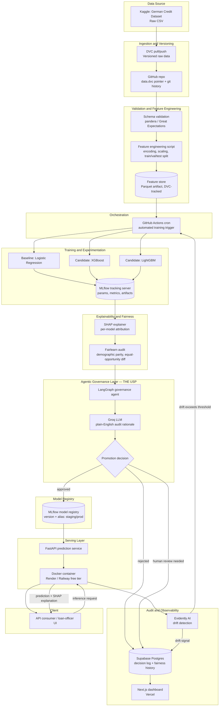

# PROJECT.md — Arbiter: Agentic Credit-Risk Governance Platform

> Master technical blueprint. This is the source of truth for architecture, sequencing, and setup — the README is the visitor-facing summary; this document is for you (and anyone cross-questioning the build).

---

## 1. Data Flow Diagram (DFD)



**How to read this:** data only moves forward through validation and feature engineering exactly once per training run. The governance layer (`GOV`) is the only node with a three-way branch — this is deliberate, because it's the interview talking point: the pipeline doesn't unconditionally promote a "better" model, it promotes a model that also clears a fairness bar, with an LLM-generated rationale attached to every decision, logged immutably.

---

## 2. Core Project Overview and USP

**What it is:** An end-to-end MLOps platform that trains, explains, and governs credit-risk classification models, then serves them through a versioned API — with every promotion decision gated by an autonomous governance agent rather than a human eyeballing a metrics dashboard.

**The problem it mirrors:** Banks (Goldman, JPM, Morgan Stanley, Barclays) run formal Model Risk Management functions. A model that predicts default risk accurately but can't be *explained* or shown to be *fair across protected groups* doesn't ship — regardless of accuracy. Most student MLOps projects stop at "I trained a model and deployed an API." This one adds the layer that actually determines whether a bank would let that model near production: governed, auditable promotion.

**The USP — Agentic Governance Copilot:**
A LangGraph-orchestrated agent sits between the MLflow registry and the promotion step. On every retrain it:
1. Pulls the new candidate's fairness metrics (demographic parity difference, equal-opportunity difference) and drift scores.
2. Calls an LLM via **Groq** (chosen for low-latency inference so the gate doesn't become a pipeline bottleneck) to generate a plain-English audit rationale — e.g., *"Model B rejected: 12% disparity in approval rate across protected group X, exceeds 5% threshold."*
3. Branches three ways: **auto-promote**, **auto-reject**, or **flag for human-in-the-loop review** — never silently deploys a model without a logged reason.
4. Writes the decision + rationale to Supabase as an immutable audit trail, visible on the dashboard.

This is the single feature that turns "I built a classifier with SHAP" into "I built the decision layer a compliance team would sign off on."

**Core ML mechanics:** binary classification (default / no-default) on the German Credit dataset. One baseline (logistic regression, interpretable by construction — useful as a sanity floor) and two candidates (XGBoost, LightGBM). Best-performing candidate that *also* clears the fairness threshold gets promoted; SHAP explanations are computed and cached per-model so every prediction served can return a "why" alongside the "what."

---

## 3. System Components

| Layer | Tool | Role | Talks to |
|---|---|---|---|
| Data versioning | DVC + GitHub | Version raw data and feature artifacts alongside code | Local filesystem, GitHub remote |
| Experiment tracking | MLflow | Logs params/metrics/artifacts for every run; hosts the model registry | Training scripts, governance agent |
| Orchestration | GitHub Actions | Cron-triggered pipeline: ingest → validate → train → evaluate → govern | Repo, MLflow, Supabase |
| Explainability | SHAP | Per-model, per-prediction attribution | Training pipeline, FastAPI serving layer |
| Fairness audit | Fairlearn | Computes demographic parity / equal-opportunity metrics per candidate | Training pipeline → governance agent |
| Governance agent | LangGraph + Groq | Reads metrics, generates rationale, makes the promote/reject/review decision | MLflow, Supabase |
| Model registry | MLflow Registry | Stores versioned, aliased models (`staging`, `production`) | FastAPI serving layer |
| Serving | FastAPI + Docker | `/predict`, `/explain`, `/health` endpoints | Client, Render/Railway |
| Hosting (API) | Render or Railway (free tier) | Runs the Dockerized FastAPI service | Public internet |
| Audit store | Supabase (Postgres) | Immutable log of every promotion decision + fairness metric history | Governance agent, dashboard |
| Drift monitoring | Evidently AI | Compares live/incoming data distribution against training distribution | Serving layer, governance agent (retrain trigger) |
| Dashboard | Next.js on Vercel | Visualizes model cards, fairness trend, decision log | Supabase (read), FastAPI (optional live metrics) |

**Communication pattern:** everything is orchestrated by GitHub Actions on a schedule (or on `data/` push). Nothing talks to anything synchronously except the live serving path (client → FastAPI → SHAP cache → response). The governance agent and drift monitor are asynchronous, batch-triggered — this mirrors how real bank retraining cadences work (nightly/weekly, not real-time).

---

## 4. Standardized Directory Structure

```
arbiter-credit-governance/
├── .github/
│   └── workflows/
│       ├── ci.yml                 # lint, unit tests, docker build test
│       └── train-pipeline.yml     # scheduled/triggered orchestration DAG-equivalent
├── configs/
│   ├── data_config.yaml           # dataset path, feature list, split ratios
│   ├── model_config.yaml          # hyperparameter grids per candidate
│   └── governance_config.yaml     # fairness thresholds, promotion rules
├── data/
│   ├── raw/                       # DVC-tracked, .gitignored actual files
│   └── processed/                 # DVC-tracked feature store output
├── data.dvc                       # DVC pointer file (committed to git)
├── src/
│   ├── ingestion/
│   │   └── load_data.py
│   ├── validation/
│   │   └── schema_checks.py       # pandera schemas
│   ├── features/
│   │   └── build_features.py
│   ├── training/
│   │   ├── train_baseline.py
│   │   ├── train_candidates.py
│   │   └── evaluate.py
│   ├── explainability/
│   │   └── shap_explainer.py
│   ├── fairness/
│   │   └── fairness_audit.py      # fairlearn wrapper
│   ├── governance/
│   │   ├── agent.py                # LangGraph graph definition
│   │   ├── rationale.py            # Groq LLM call
│   │   └── decision_log.py         # writes to Supabase
│   ├── serving/
│   │   ├── main.py                 # FastAPI app
│   │   ├── schemas.py              # Pydantic request/response models
│   │   └── inference.py
│   └── monitoring/
│       └── drift_check.py          # Evidently AI wrapper
├── dashboard/                      # Next.js app, deployed separately to Vercel
│   ├── pages/
│   └── components/
├── tests/
│   ├── test_features.py
│   ├── test_inference.py
│   └── test_api_integration.py
├── docs/
│   ├── model_card.md
│   ├── data_card.md
│   └── responsible_ai_statement.md
├── Dockerfile
├── docker-compose.yml
├── requirements.txt
├── .env.example
├── PROJECT.md
└── README.md
```

---

## 5. Sequential Development Roadmap

No rigid phases — build in this order because each step's output is the next step's input. Treat it as a checklist you move down, not a set of milestones with gates.

1. **Repo + environment skeleton.** Initialize the repo with the directory structure above, `requirements.txt`, `.env.example`, and a fixed random seed constant in `configs/`. Set up a virtualenv. This is boring but skipping it is exactly why student projects fall apart at step 8.

2. **Pull and version the raw data.** Download the German Credit dataset, drop it in `data/raw/`, `dvc add` it, push to a DVC remote (Google Drive or an S3-free-tier bucket both work). Commit `data.dvc`, not the CSV itself.

3. **Write schema validation before you write feature engineering.** Use `pandera` to define expected dtypes, ranges, and null-tolerance for every raw column. This script runs *first* in the pipeline and should hard-fail on schema violations — this is the step most tutorials skip and the one that actually distinguishes "MLOps" from "a notebook."

4. **Feature engineering.** Encode categoricals, scale numerics, produce a deterministic train/val/test split (seeded). Output goes to `data/processed/`, also DVC-tracked. Keep this as a pure function — no side effects — so it's trivially unit-testable.

5. **Baseline model.** Logistic regression, trained and logged to MLflow with params, metrics (AUC, precision/recall, F1), and the model artifact itself. This is your interpretability floor — every candidate has to beat it *and* stay explainable.

6. **Candidate models.** XGBoost and LightGBM, each logged as a separate MLflow run. At this point you should be able to open the MLflow UI and see three runs with comparable metrics side by side — this is the artifact you screenshot for the submission requirements.

7. **SHAP explainability.** For each of the three logged models, compute SHAP values on the validation set and save summary plots as MLflow artifacts. Also write a standalone function that can compute SHAP for a *single* prediction — you'll reuse this in the serving layer.

8. **Fairness audit.** Using `fairlearn`, compute demographic parity difference and equal-opportunity difference per candidate, keyed on a protected attribute in the dataset (e.g., age group or foreign-worker status in German Credit). Log these as MLflow metrics too, not just console output — they need to be queryable by the governance agent later.

9. **Governance agent — build this before the registry step, not after.** Define the LangGraph graph: a node that queries MLflow for the latest run's metrics + fairness scores, a node that calls Groq with those numbers to generate a rationale string, and a conditional edge that routes to `promote`, `reject`, or `human_review` based on `governance_config.yaml` thresholds. Test this in isolation with mocked MLflow data before wiring it to the real pipeline — it's the component most likely to have subtle bugs.

10. **Wire the agent to the registry.** On `promote`, the agent calls MLflow's registry API to set the model's alias to `staging` (then `production` after your own manual sign-off, since a real bank would never let an agent go straight to prod). On `reject` or `human_review`, no registry action — only a Supabase log entry.

11. **Supabase audit log.** Create a `decisions` table (run_id, model_version, decision, rationale, fairness_metrics jsonb, timestamp). Write to it from `decision_log.py`. This table is what your dashboard reads.

12. **FastAPI serving layer.** `/health`, `/predict` (returns class + probability), `/explain` (returns SHAP values for that specific prediction). Pull the `production`-aliased model from the MLflow registry at startup, not per-request. Add Pydantic input validation so malformed requests fail with a clean 422, not a stack trace.

13. **Dockerize.** Single `Dockerfile` for the API, `docker-compose.yml` if you're running MLflow locally alongside it. Confirm the image builds and the container serves a prediction before moving on.

14. **CI pipeline.** GitHub Actions workflow: lint → unit tests (`test_features.py`, `test_inference.py`) → Docker build test → (optional) API integration test hitting the running container. This is a separate workflow file from the training pipeline.

15. **Training pipeline as GitHub Actions.** Wire steps 2–11 into a single scheduled/triggered workflow (`train-pipeline.yml`). This is your Airflow-DAG-equivalent — document in the README exactly why you chose this over a hosted Airflow instance (cost, and the DAG shape is genuinely linear enough not to need Airflow's branching/backfill features).

16. **Drift monitoring.** `drift_check.py` using Evidently AI, comparing a holdout "production-like" batch against training data statistics. Wire it to run periodically (or on-demand) and, if drift exceeds a threshold, trigger the training pipeline via a `workflow_dispatch` API call — this closes the loop shown in the DFD.

17. **Dashboard.** Next.js app reading from Supabase: a table of promotion decisions with rationale, a fairness-metric trend chart, and the current production model's card. Deploy to Vercel. This is the artifact a recruiter or interviewer actually looks at first.

18. **Documentation.** Model card, data card, responsible-AI statement (privacy, intended use, known limitations) in `docs/`. Write these last, once you know what the system actually does — writing them first produces documentation that doesn't match the build.

19. **Drift simulation for the demo.** Deliberately perturb a batch of live-simulated data (shift a feature distribution), run it through `/predict`, show the drift monitor catching it and triggering a retrain, show the governance agent's rationale on the resulting candidate. This is your five-minute live demo script.

20. **Cloud extension (optional, do last).** Swap local MLflow artifact storage for an S3 bucket, note in the README how a SageMaker training job would slot in. Don't actually provision SageMaker unless you're demoing that specific day — tear it down immediately after.

---

## 6. Setup and Run Instructions

### 6.1 Environment setup

```bash
# clone and enter the repo
git clone https://github.com/<your-username>/arbiter-credit-governance.git
cd arbiter-credit-governance

# create and activate a virtual environment
python3 -m venv .venv
source .venv/bin/activate        # Windows: .venv\Scripts\activate

# install dependencies
pip install -r requirements.txt

# copy env template and fill in secrets
cp .env.example .env
# edit .env: GROQ_API_KEY, SUPABASE_URL, SUPABASE_KEY, MLFLOW_TRACKING_URI
```

### 6.2 Pull versioned data

```bash
# configure your DVC remote once (example: Google Drive)
dvc remote add -d storage gdrive://<your-folder-id>

# pull the tracked dataset
dvc pull
```

### 6.3 Run the training pipeline locally (before automating it)

```bash
# start a local MLflow tracking server
mlflow server --backend-store-uri sqlite:///mlflow.db \
    --default-artifact-root ./mlruns \
    --host 0.0.0.0 --port 5000

# in a second terminal, run each pipeline stage in order
python src/validation/schema_checks.py
python src/features/build_features.py
python src/training/train_baseline.py
python src/training/train_candidates.py
python src/explainability/shap_explainer.py
python src/fairness/fairness_audit.py
python src/governance/agent.py
```

Open `http://localhost:5000` to inspect runs, metrics, and the model registry.

### 6.4 Serve the model locally

```bash
uvicorn src.serving.main:app --reload --host 0.0.0.0 --port 8000
```

Test it:

```bash
curl -X POST http://localhost:8000/predict \
  -H "Content-Type: application/json" \
  -d '{"age": 35, "credit_amount": 4500, "duration_months": 24, "purpose": "car"}'

curl http://localhost:8000/health
```

### 6.5 Run with Docker

```bash
docker build -t arbiter-api .
docker run -p 8000:8000 --env-file .env arbiter-api

# or, with MLflow bundled:
docker compose up --build
```

### 6.6 Run tests

```bash
pytest tests/ -v
```

### 6.7 Trigger the full automated pipeline (GitHub Actions)

No local command needed — push to `main` or trigger manually:

```bash
gh workflow run train-pipeline.yml
```

### 6.8 Run the dashboard

```bash
cd dashboard
npm install
npm run dev        # local dev on http://localhost:3000
# deploy: vercel --prod
```
